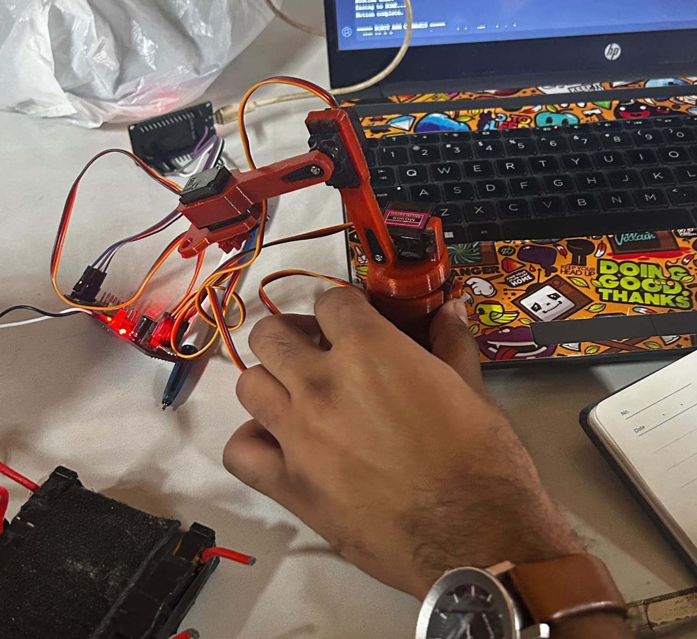
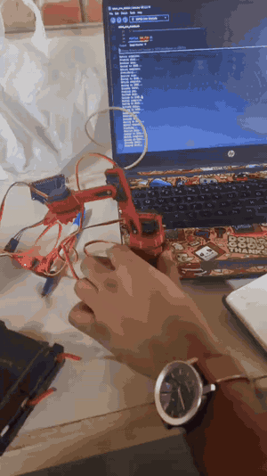
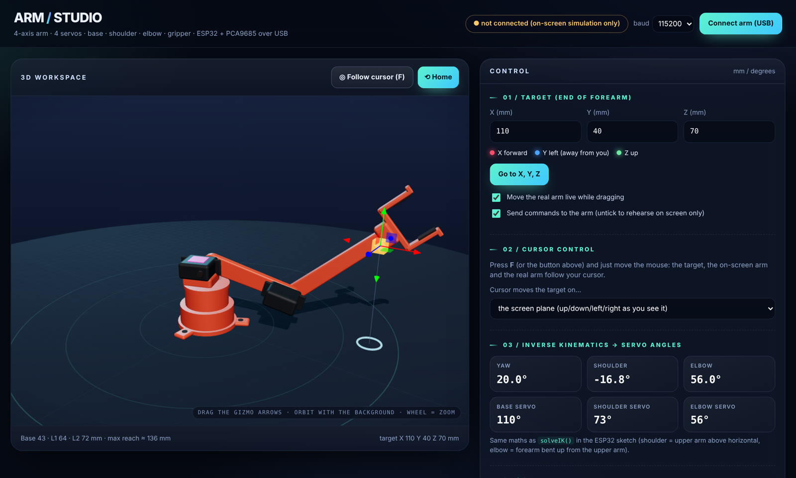
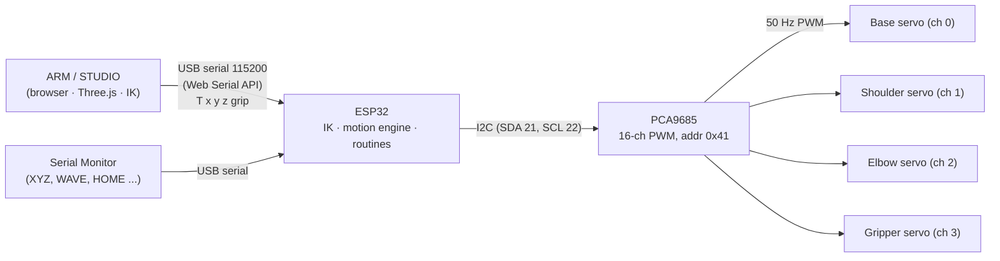

# 4-DOF Robotic Arm · ESP32 + PCA9685 + Web Control

> My **first robotic arm**: a 3D-printed, 4-servo arm driven by an ESP32, with custom firmware (inverse kinematics + smooth motion + playful routines) and a browser-based 3D control studio that talks to the arm over USB.


<table>
  <tr>
    <td align="center"><br><sub><b>The finished arm (v1)</b></sub></td>
    <td align="center"><a href="media/working_demo.mp4"></a><br><sub><b>Working demo</b> · <a href="media/working_demo.mp4">full video (mp4)</a></sub></td>
  </tr>
</table>

---

## Why this project exists

This is the first robot arm I designed, printed, wired and programmed end to end. The goal was **learning**: how hobby servos are driven, how inverse kinematics turns an (x, y, z) point into joint angles, and how to make motion look smooth instead of jerky. It works, it has rough edges, and it is the foundation for a better v2 (see [Roadmap](#roadmap)).

## Features

- **4 degrees of freedom**: base yaw, shoulder, elbow, plus a gripper servo.
- **Inverse kinematics on the ESP32**: give it `XYZ 10 0 8` (cm) and it solves the joint angles (analytic, law of cosines), with reach, joint-limit and table-collision checks.
- **Smooth motion engine**: minimum-jerk easing, per-joint peak speed limits, and an acceleration-limited "live" mode for streamed targets. A master `SPEED` knob scales everything.
- **8 built-in routines**: `STRETCH` (runs at power-on), `WAVE`, `NOD`, `DANCE`, `PEEKABOO`, `POUNCE`, `STARTLED`, `PLAY DEAD`. Non-blocking, so `STOP` works mid-routine.
- **Safe startup**: clears stale PCA9685 outputs and powers servos up one at a time (optional OE pin support) to avoid a violent jump on boot.
- **ARM / STUDIO web interface**: a 3D workspace where you drag a target, or press `F` and the arm follows your cursor. The page runs the same IK as the firmware, shows servo angles, and streams targets to the real arm over USB (Web Serial). It works as an on-screen simulator without hardware, and can load your own STL parts.
- **Serial console** for debugging, plus a documented [command set](docs/serial-commands.md).

<p align="center">
  <br>
  <sub>ARM / STUDIO: the browser control page (shown in simulation mode, no arm connected).</sub>
</p>

## System overview



## Hardware

| Part | Detail |
|---|---|
| Controller | ESP32 dev board |
| Servo driver | PCA9685 (I2C address `0x41`, 50 Hz) |
| Actuators | 4 hobby servos (base, shoulder, elbow, gripper), pulse range 600-2300 µs |
| Structure | 3D-printed links and base (see [`cad/`](cad/)) |
| Link lengths | Base height 43 mm · shoulder→elbow 64 mm · elbow→tip 72 mm · max reach ≈ 136 mm |

Full parts list: [`hardware/bill-of-materials.md`](hardware/bill-of-materials.md) · Wiring: [`hardware/wiring.md`](hardware/wiring.md)

## Quick start

### 1. Flash the firmware

1. Install the Arduino IDE with the **ESP32 board package**, and the **Adafruit PWM Servo Driver Library** (Library Manager).
2. Open [`firmware/robot_arm_stretch/robot_arm_stretch.ino`](firmware/robot_arm_stretch/robot_arm_stretch.ino).
3. Check `PCA_ADDRESS` (`0x41` here; many boards use `0x40`), the I2C pins, and your joint limits. See [calibration](docs/calibration.md).
4. Upload, open the Serial Monitor at **115200 baud, Newline**. The arm stretches, then settles at HOME. Type `HELP` for commands.

> Power the servos from a proper external supply (not the ESP32's pins) and join the grounds. See [wiring](hardware/wiring.md).

### 2. Try some commands

```text
XYZ 10 0 8      move the forearm tip to x=10, y=0, z=8 cm
WHERE           print where the tip is now (forward kinematics)
WAVE            wave hello
SPEED 0.6       slow everything down
STOP            freeze in place
```

### 3. Use the web interface

1. Open [`web-interface/arm_studio.html`](web-interface/arm_studio.html) in **Chrome or Edge** (Web Serial is not available in Firefox/Safari). It loads Three.js from a CDN, so it needs an internet connection.
2. Click **Connect arm (USB)** and pick the ESP32's port. (Close the Arduino Serial Monitor first; only one program can hold the port.)
3. Drag the gizmo, type X/Y/Z, or press **F** to make the arm follow your cursor.

## Repository layout

```text
.
├── firmware/robot_arm_stretch/   ESP32 sketch (IK, motion engine, routines, serial commands)
├── web-interface/arm_studio.html Single-file 3D control page (Three.js + Web Serial)
├── cad/                          3D-printed parts: links and notes
├── hardware/                     Bill of materials and wiring
├── docs/                         Serial commands, calibration, how it works
└── media/                        Photos, screenshot, demo video
```

## How it works (short version)

- **Kinematics**: the base rotates to face the target (`atan2(y, x)`); the shoulder and elbow form a 2-link planar arm solved with the law of cosines (elbow-down solution). The same maths runs in the firmware and in the web page, so the on-screen arm matches the real one. Details in [`docs/how-it-works.md`](docs/how-it-works.md).
- **Motion**: normal commands use a minimum-jerk curve with a shared duration for all joints, so they start and arrive together and no joint exceeds its speed limit. Streamed web targets use a speed- and acceleration-limited follower for smooth live tracking.
- **Safety**: every target is checked for reach, per-joint limits and table collision before moving.

## What I learned

- A PCA9685 **keeps its last PWM output across an ESP32 reset**, so the firmware clears all channels first and brings the servos up one by one to avoid a jump at boot.
- Opening the serial port from the browser **resets the ESP32**, so the web page waits for the boot message before streaming commands.
- Servos that move at full speed look and feel harsh; easing plus per-joint speed ceilings makes the arm far more natural (and kinder to the printed parts).
- Kinematics only works if the **link lengths, offsets and limits in the firmware and the web page match** the real arm. Calibration matters as much as the maths.

## Known limitations (v1)

- No position feedback: hobby servos are open loop, so accuracy depends on calibration.
- The gripper's own length is not modelled in the collision check; leave margin in low poses.
- Web interface needs Chrome/Edge and an internet connection (CDN assets).
- Wiring in the photo is a bench setup, not a tidy enclosure.

## Roadmap

Ideas for the next, better arm (v2):

- [ ] Wrist joint for more orientation control (5-6 DOF)
- [ ] Stiffer structure and higher-torque, metal-gear servos
- [ ] Cleaner wiring: custom PCB or enclosed electronics, proper power distribution
- [ ] Position feedback (encoders or feedback servos)
- [ ] ROS 2 interface and MoveIt-style planning
- [ ] Offline web interface (bundle Three.js locally)

## Credits & license

Designed, built and programmed by **Divyom Srivastava** ([@DivyomSrivastava](https://github.com/DivyomSrivastava)).
3D model source and credits: see [`cad/README.md`](cad/README.md).
Released under the [MIT License](LICENSE).
