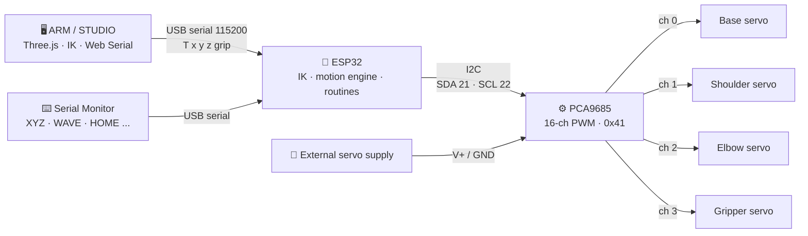

<p align="center">
  
</p>

<div align="center">


<br>

<table>
  <tr>
    <td align="center"><br><sub><b>The finished arm (v1)</b></sub></td>
    <td align="center"><br><sub><b>Working demo</b> (plays right here)</sub></td>
  </tr>
</table>

</div>

---

## 📑 Contents

| | | | |
|---|---|---|---|
| [📌 At a glance](#-at-a-glance) | [✨ Features](#-features) | [🖥️ Web interface](#️-web-interface-arm--studio) | [🧩 System overview](#-system-overview) |
| [🔌 Connections](#-connections) | [🚀 Quick start](#-quick-start) | [⌨️ Commands](#️-commands) | [🧠 How it works](#-how-it-works) |
| [📁 Repo layout](#-repository-layout) | [🎓 What I learned](#-what-i-learned) | [⚠️ Limitations](#️-known-limitations) | [🗺️ Roadmap](#️-roadmap) |

---

## 📌 At a glance

| Spec | Value |
|---|---|
| **Degrees of freedom** | 4 servos: base yaw, shoulder, elbow, gripper |
| **Controller** | ESP32 dev board |
| **Servo driver** | PCA9685, I2C address `0x41`, 50 Hz |
| **Link lengths** | Base height 43 mm · upper arm 64 mm · forearm 72 mm |
| **Max reach** | ≈ 136 mm from the shoulder axis |
| **Control** | Serial commands, or the ARM / STUDIO browser app over USB |
| **Motion** | Minimum-jerk easing, per-joint speed limits, live acceleration-limited tracking |
| **Built-in routines** | 8 (`STRETCH`, `WAVE`, `NOD`, `DANCE`, `PEEKABOO`, `POUNCE`, `STARTLED`, `PLAY DEAD`) |
| **Structure** | 3D-printed (see [`cad/`](cad/)) |

## ✨ Features

| Feature | What it does |
|---|---|
| 🎯 **Inverse kinematics on the ESP32** | `XYZ 10 0 8` (cm) solves the joint angles on the board, checking reach, joint limits and table collision before moving |
| 🌊 **Smooth motion** | Minimum-jerk easing, one shared duration so all joints arrive together, per-joint peak speeds, master `SPEED` knob |
| 📡 **Live tracking** | Streamed targets from the web page are followed with limited speed and acceleration, so dragging feels smooth |
| 🎭 **Personality** | Eight non-blocking routines; `STRETCH` is a "waking up" sequence at power-on; `STOP` works mid-routine |
| 🛡️ **Safe startup** | Clears stale PCA9685 outputs and brings servos up one at a time (optional OE pin) to avoid a jump at boot |
| 🖥️ **Browser control studio** | 3D workspace that mirrors the firmware's maths and talks to the real arm over USB |

## 🖥️ Web interface (ARM / STUDIO)

<p align="center">
  <br>
  <sub>The control page in simulation mode (no arm connected).</sub>
</p>

| Capability | How |
|---|---|
| Drag a 3D target | Gizmo arrows in the workspace |
| Follow the cursor | Press **F** (or the button), `Esc` to stop |
| Type exact positions | X / Y / Z in mm, then **Go** |
| See the maths | Live joint and servo angles from the same IK as the firmware |
| Control the gripper | 0 % (open) to 100 % (closed) slider |
| Rehearse safely | Untick *Send commands to the arm* to use it as a simulator |
| Debug | Built-in serial console |
| Use your own parts | Load STL files onto each joint |
| **Requirements** | Chrome or Edge (Web Serial API) and an internet connection (Three.js loads from a CDN) |

## 🧩 System overview



## 🔌 Connections

### ESP32 ↔ PCA9685

| ESP32 pin | PCA9685 pin | Signal |
|---|---|---|
| GPIO 21 | SDA | I2C data |
| GPIO 22 | SCL | I2C clock (100 kHz) |
| 3V3 | VCC | Logic power (typical setup) |
| GND | GND | Common ground |
| *(optional)* any free GPIO | OE | Output enable; set `OE_PIN` in the sketch (default `-1` = not wired) |

### PCA9685 ↔ servos

| PCA9685 channel | Joint | Software limit | Notes |
|---|---|---|---|
| 0 | Base (yaw) | 0° – 180° | 90° = pointing forward |
| 1 | Shoulder | 5° – 175° | 90° = upper arm horizontal |
| 2 | Elbow | 5° – 175° | 5° ≈ fully straight, 90° = forearm vertical |
| 3 | Gripper | 30° – 110° | 40° = open, 100° = closed |

Servo pulse range: 600 – 2300 µs at 50 Hz. Standard hobby-servo wiring: signal (orange/yellow) to the channel's signal pin, V+ (red) and GND (brown/black) to the same channel header.

### Power

| From | To | Note |
|---|---|---|
| External supply **V+** | PCA9685 **V+** terminal | Powers the servos; do not run them from the ESP32 pins |
| External supply **GND** | PCA9685 **GND** and ESP32 **GND** | Common ground is required |
| Computer USB | ESP32 | ESP32 power, firmware upload and serial control |

More in [`hardware/wiring.md`](hardware/wiring.md) · Parts list: [`hardware/bill-of-materials.md`](hardware/bill-of-materials.md)

## 🚀 Quick start

| Step | Action | Details |
|---|---|---|
| **1** | Set up Arduino | Install the Arduino IDE, the **ESP32 board package** and the **Adafruit PWM Servo Driver Library** |
| **2** | Open the sketch | [`firmware/robot_arm_stretch/robot_arm_stretch.ino`](firmware/robot_arm_stretch/robot_arm_stretch.ino) |
| **3** | Check settings | `PCA_ADDRESS` (`0x41` here, many boards use `0x40`), I2C pins, joint limits. See [`docs/calibration.md`](docs/calibration.md) |
| **4** | Upload and test | Open the Serial Monitor at **115200 baud, Newline**. The arm stretches, then settles at HOME. Type `HELP` |
| **5** | Open the web app | [`web-interface/arm_studio.html`](web-interface/arm_studio.html) in **Chrome or Edge** |
| **6** | Connect | Click **Connect arm (USB)** and pick the ESP32's port (close the Arduino Serial Monitor first) |
| **7** | Play | Drag the gizmo, type X/Y/Z, or press **F** to make the arm follow your cursor |

## ⌨️ Commands

Serial at **115200 baud, Newline**. Full reference: [`docs/serial-commands.md`](docs/serial-commands.md).

| Command | What it does |
|---|---|
| `XYZ 10 0 8` | Move the forearm tip to x, y, z in cm (x forward, y left, z up) |
| `WHERE` | Print the tip position (forward kinematics) |
| `HOME` | Glide to the 90 / 90 / 90 / 90 pose |
| `ANGLES 90 90 90 90` | Set base, shoulder, elbow, gripper directly |
| `GRIP OPEN` / `GRIP CLOSE` | Open or close the gripper |
| `SPEED 0.6` | Master speed, 0.2 – 1.0 |
| `STOP` | Freeze in place and cancel any routine |
| `STRETCH` · `WAVE` · `NOD` · `DANCE` | Routines |
| `PEEKABOO` · `POUNCE` · `STARTLED` · `PLAY DEAD` | More routines |

## 🧠 How it works

```text
base     = atan2(y, x)
r, h     = horizontal distance, height above the shoulder axis
cos(e)   = (r² + h² − L1² − L2²) / (2·L1·L2)                 → elbow bend
shoulder = atan2(h, r) − atan2(L2·sin(e), L1 + L2·cos(e))    → shoulder angle
```

| Part | How it works |
|---|---|
| **Kinematics** | Base turns to face the target; shoulder and elbow are solved as a 2-link planar arm (elbow-down solution). The same maths runs in the firmware and the web page, so the on-screen arm matches the real one |
| **Eased moves** | Minimum-jerk curve; all joints share one duration and none exceeds its peak speed |
| **Live mode** | Speed- and acceleration-limited follower for streamed targets |
| **Safety** | Every target is checked for reach, per-joint limits and table collision before moving |
| **Update rate** | 50 Hz motion loop |

Deeper dive: [`docs/how-it-works.md`](docs/how-it-works.md) · Tuning: [`docs/calibration.md`](docs/calibration.md)

## 📁 Repository layout

| Path | Contents |
|---|---|
| [`firmware/robot_arm_stretch/`](firmware/robot_arm_stretch/) | ESP32 sketch: IK, motion engine, routines, serial commands |
| [`web-interface/arm_studio.html`](web-interface/arm_studio.html) | Single-file 3D control page (Three.js + Web Serial) |
| [`cad/`](cad/) | 3D-printed parts and model source |
| [`hardware/`](hardware/) | Bill of materials and wiring |
| [`docs/`](docs/) | Serial commands, calibration, how it works |
| [`media/`](media/) | Header, photos, UI screenshot, demo video |

## 🎓 What I learned

| Lesson | What I did about it |
|---|---|
| A PCA9685 **keeps its last PWM output across an ESP32 reset** | Clear every channel at boot and power the servos up one by one |
| Opening the serial port from a browser **resets the ESP32** | The web page waits for the board to restart before streaming commands |
| Full-speed servo moves look and feel harsh | Easing plus per-joint speed ceilings for natural, gentler motion |
| Kinematics only works if the numbers match the real arm | Keep link lengths, offsets and limits identical in firmware and web page, and calibrate |

## ⚠️ Known limitations

| Limitation | Impact |
|---|---|
| Open-loop hobby servos, no position feedback | Accuracy depends on calibration |
| Gripper length not modelled in the collision check | Leave margin in low poses |
| Web interface needs Chrome/Edge and internet | Not usable offline or in Firefox/Safari |
| Bench wiring, not an enclosure | Fine for testing, not tidy |

## 🗺️ Roadmap

| Status | Idea for v2 |
|---|---|
| ⬜ | Wrist joint for orientation control (5–6 DOF) |
| ⬜ | Stiffer structure and higher-torque, metal-gear servos |
| ⬜ | Cleaner electronics: custom PCB or enclosure, proper power distribution |
| ⬜ | Position feedback (encoders or feedback servos) |
| ⬜ | ROS 2 interface and motion planning |
| ⬜ | Offline web interface with Three.js bundled locally |

## 🤝 Credits & license

| | |
|---|---|
| **Author** | Divyom Srivastava ([@DivyomSrivastava](https://github.com/DivyomSrivastava)) |
| **3D model source** | See [`cad/README.md`](cad/README.md) |
| **License** | [MIT](LICENSE) |

<div align="center">

⭐ If this helped you with your own first arm, consider starring the repo.

</div>
